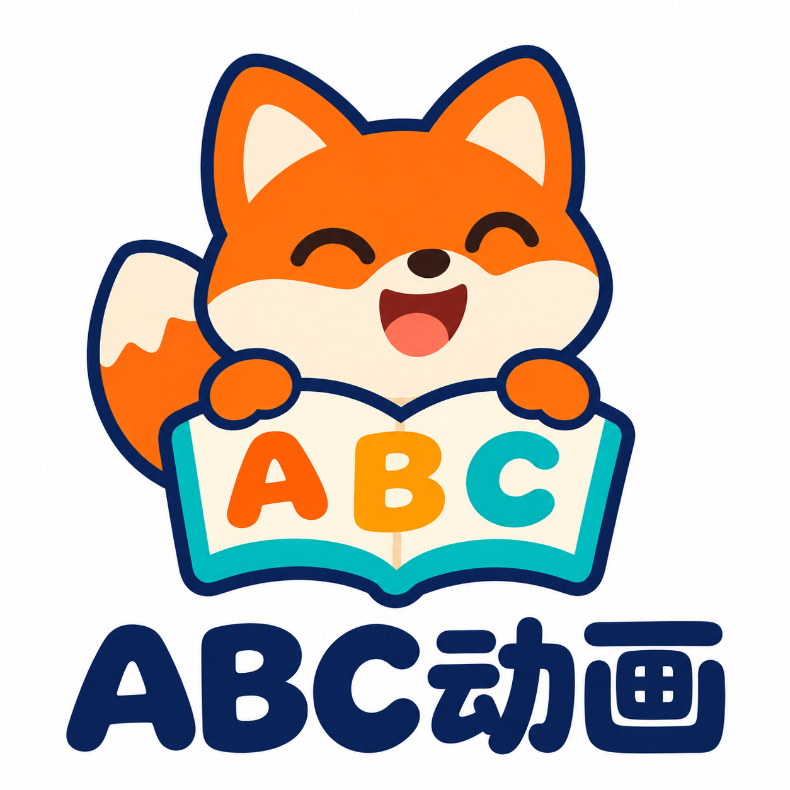
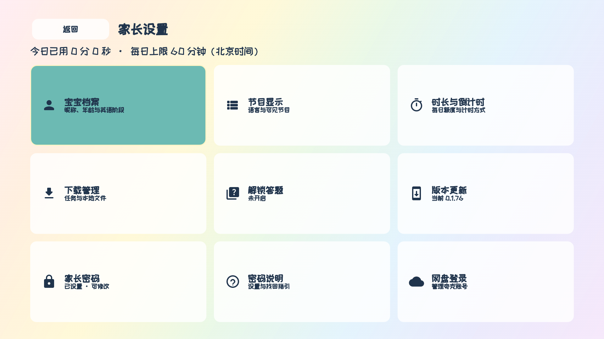
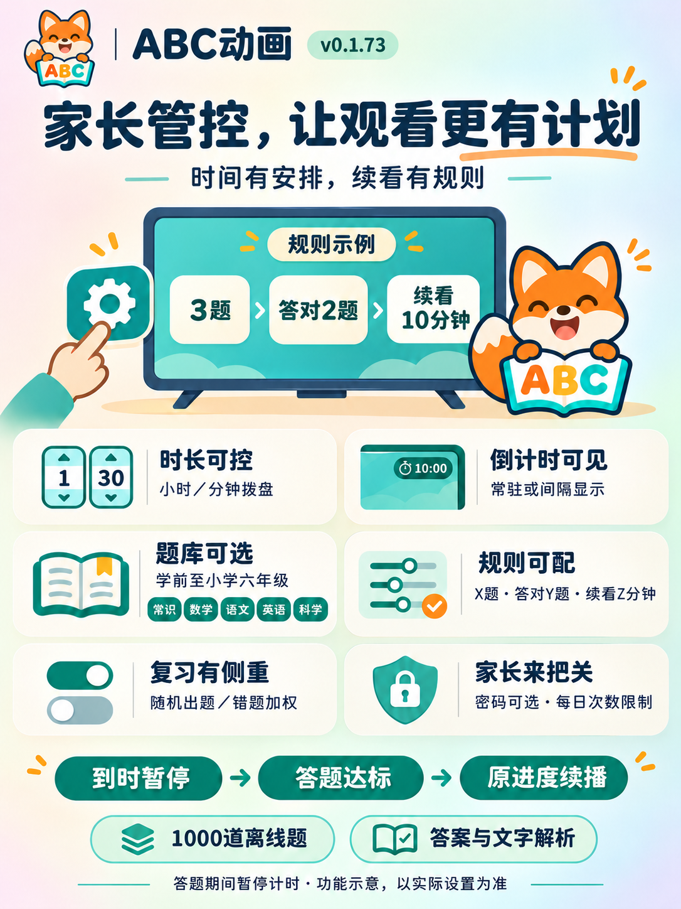
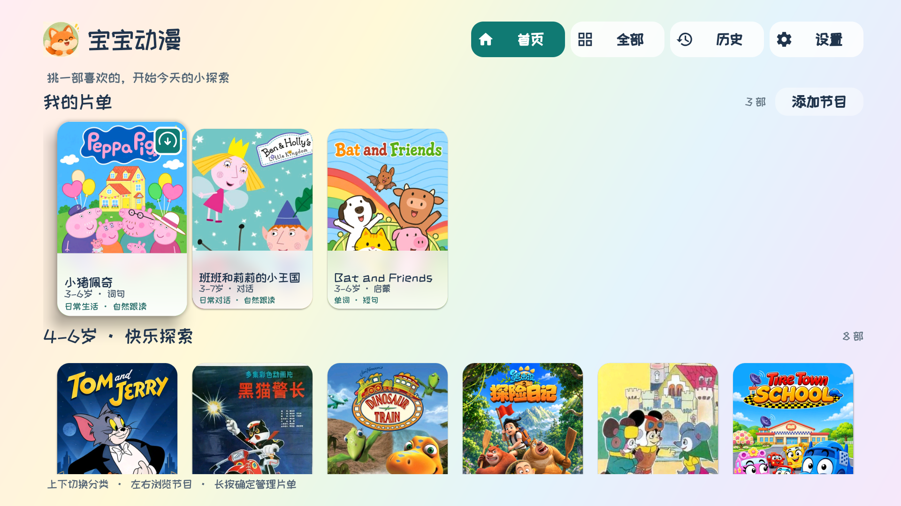
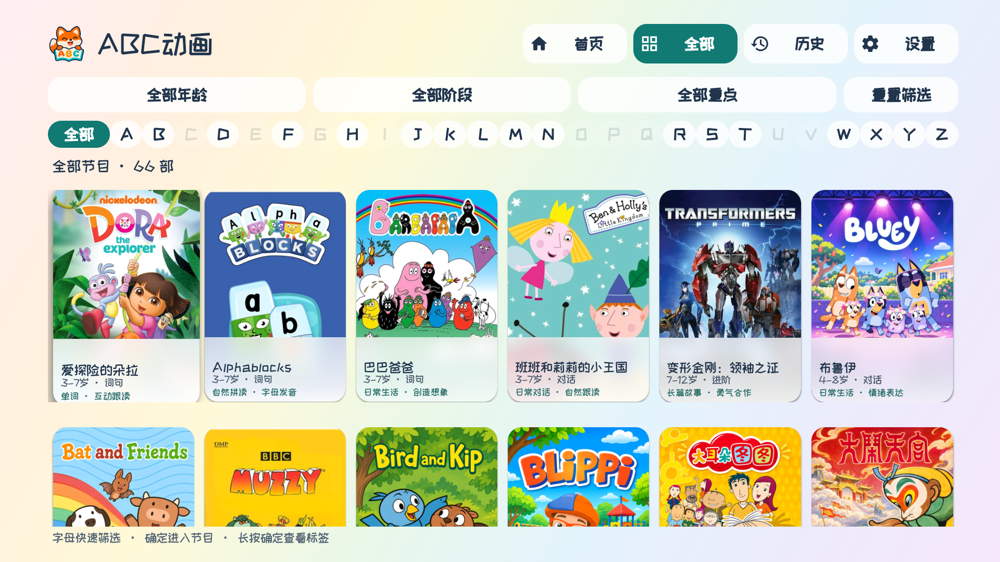
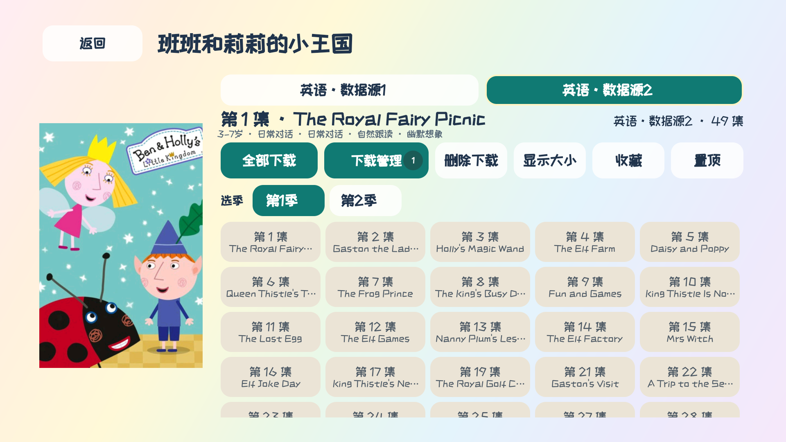
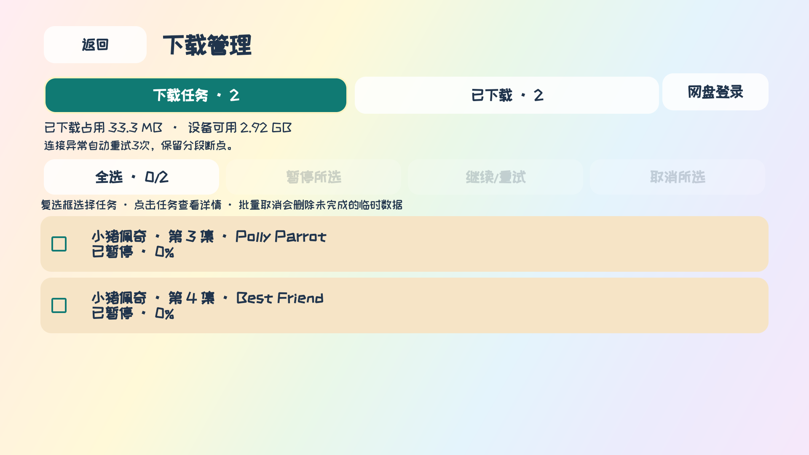
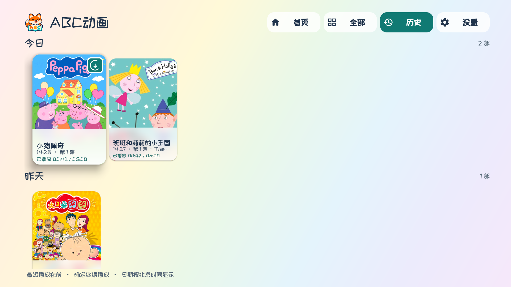

# ABC动画

[下载电视版 · 58.0 MB](https://www.dajinsuan.com/tvapp/abc-animation/v0.1.78/ABCAnimation-TV-0.1.78.apk) · [下载通用版 · 81.8 MB](https://www.dajinsuan.com/tvapp/abc-animation/v0.1.78/ABCAnimation-0.1.78.apk) · [全部版本](https://github.com/suqianqiu/abc-animation/releases) · [操作手册](docs/USER_GUIDE.md) · [问题反馈](https://github.com/suqianqiu/abc-animation/issues/new/choose)

**让孩子容易找到喜欢的内容，让家长更方便地安排观看。**

ABC动画是一款面向 Android TV 的家庭动画管理与观看应用，以英语启蒙和亲子陪伴为主要方向。家长可以结合孩子的年龄与英语基础选片，管理下载、查看播放历史，并设置每日可用时长；也可由家长开启答题续看，约定到时后的继续观看规则。

本项目用于个人学习、产品交流与家庭场景探索，**不以营利为目的**。

> 观看提醒：**2岁半之前不建议观看动画。** 请由家长选择适合的内容、控制时长并陪伴观看。节目年龄标签仅供选片参考。

## 希望解决什么问题

- **选片更轻松**：按年龄、英语阶段和学习重点浏览，减少反复查找。
- **遥控器操作更直接**：以海报为主要入口，切换分类时保留上次位置。
- **观看安排更清楚**：管理已下载内容、继续最近观看，并设置可见的倒计时。
- **让家长保留选择权**：可调整宝宝档案、节目显示、语言偏好和每日时长。

## 可以做什么

| 功能 | 使用体验 |
| --- | --- |
| 首页推荐 | 保存年龄与英语基础后，相应分类会优先展示；可收藏、置顶或添加到“我的片单”。 |
| 全部节目 | 支持首字母、年龄、英语阶段及学习重点筛选。 |
| 节目详情 | 查看季、语言和分集，选择下载；多个同语言入口会用“数据源1/2”等标识区分。 |
| 下载提示 | 海报、季／语言入口和分集显示下载角标；未完成时持续动画，新完成后显示白框和绿色“新”提醒。 |
| 下载管理 | 查看任务，批量暂停、继续、重试或取消；已下载文件可打开播放、批量管理。 |
| 本地观看 | 下载完成后播放，保存进度；下一集已下载时可连续播放。音轨、字幕以具体文件提供的内容为准。 |
| 最近历史 | 按日期展示最近观看的节目，每个节目只显示最近一次，方便继续播放。 |
| 家长控制 | 管理宝宝档案、节目显示；用小时／分钟双列拨盘设置每日时长，支持倒计时显示，设置密码后，相关管理操作需要验证。 |
| 版本更新 | 每天后台检查，也可由家长手动检查、下载并按系统提示升级。 |
| 答题续看 | 自定通过门槛与续看时间，选择题库，独立开启随机出题和错题复习。 |

## 0.1.78 更新：腾讯云优先，GitHub备用

版本检查和安装包下载优先使用腾讯云香港COS；失败时自动尝试GitHub。中断保留进度，继续验证完整安装包摘要和签名。上方安装包链接优先走腾讯云；[GitHub备用下载](https://github.com/suqianqiu/abc-animation/releases/tag/v0.1.78)。

微鲸Android 5已验证生产升级代码完整下载及校验；系统安装由用户手动测试。老版本需要先覆盖安装一次，才能获得新的升级地址。[升级说明](docs/UPDATE_COMPATIBILITY.md)。

## 0.1.77 更新：旧电视升级证书兼容

修复Android 5.0缺少升级服务器根证书、导致无法检查新版本的问题；保留HTTPS证书链及域名校验。微鲸实机网络诊断已取得版本信息和APK分片。

**原版0.1.74–0.1.76若已无法检查更新，需要先从电脑下载0.1.77覆盖安装一次。** 这是0.1.77当时的验证范围；0.1.78已增加腾讯云优先更新。[兼容说明与验证边界](docs/UPDATE_COMPATIBILITY.md)。

## 0.1.76 更新

- **焦点行居中**：首页上下选行时保持焦点海报居中，首尾按边界停住，快速连按跟随最新选择。
- **微鲸旧系统滚动**：系统关闭动画时仍保留应用内连续滚动，不修改电视全局设置。
- **家长设置更整齐**：九个入口统一为3×3图标按钮，16dp间距，整页无需滚动。
- **合并0.1.75弹窗优化**：按钮至少120×48dp，长内容内部滚动，底部操作区保持可见。

微鲸和AM9 Pro最终各56项通过；通用版完成与电视版代码/资源一致性及签名验证。具体范围和限制见[更新日志](docs/CHANGELOG.md)。

## 0.1.74 更新

- 每天首次打开应用时，在后台检查正式新版本；有更新时提示家长，不影响本地观看。
- 在“设置 → 家长设置 → 版本更新”中查看更新说明、手动检查、下载与安装；下载中断后可继续。
- 首次升级引导开启“允许来自此来源”，返回后继续安装；保留登录、密码、设置和已下载内容。
- 保留现有播放器、1000道文字题库与答题续看功能，电视版约58.0 MB，通用版约81.8 MB。

**首次使用应用内更新，需要先覆盖安装本版。** 每次安装仍需按电视的系统提示确认；部分电视可能限制第三方安装。

## 答题续看

家长可以设置“每轮 X 题、至少答对 Y 题、续看 Z 分钟”，选择学前至小学六年级的题库、科目和题型，并独立开关随机出题与错题加权。

- **1000道离线题**：覆盖常识、数学、语文、英语、科学，含单选与判断，提供文字答案与解析。
- **双入口**：“家长设置 → 解锁答题”，或“家长设置 → 时长与倒计时 → 解锁答题”。入口始终显示，功能默认关闭，由家长开启并保存。
- **有边界的续看**：可限制每日成功次数及每次到时的尝试轮数；答题与结果页暂停计时，通过后可从原进度继续。

[查看家长管控功能说明](docs/PARENTAL_CONTROLS.md) · [按步骤设置](docs/USER_GUIDE.md#10-解锁答题与续看)

海报沿用0.1.73的管控功能示意，数字采用演示规则，实际设置由家长决定。[下载海报原图](https://github.com/suqianqiu/abc-animation/releases/download/v0.1.73/ABCAnimation-Parental-Controls-v0.1.73.png)。

## 页面预览

以下为核心页面截图；新增0.1.76实机首页及家长设置截图，其他页面沿用已标注版本的演示画面。部分页面使用演示档案、播放记录或下载状态，不代表默认设置、内容授权或对具体节目的推荐。

| 首页 | 全部节目 |
| --- | --- |
|  |  |
| 节目详情 | 下载管理 |
|  |  |
| 最近历史 | 家长与时长设置 |
|  |  |

[查看全部核心页面](docs/SCREENSHOTS.md) · [产品目标与用途](docs/PRODUCT.md) · [操作手册](docs/USER_GUIDE.md)

## 开始使用

1. 在兼容的 Android TV 设备上安装应用，使用遥控器进入首页。
2. 由家长进入“设置 → 家长设置”，检查年龄、英语基础、节目显示和每日时长。
3. 选择有合法使用权限的内容，按需要下载；下载完成后打开观看。

本版提供两种安装包，均可离线答题、从本地播放已下载的视频：

| 安装包 | 大小 | 适用设备 |
| --- | --- | --- |
| 电视版 | 约58.0 MB | 支持32位／64位ARM的电视或盒子。 |
| 通用版 | 约81.8 MB | ARM设备，以及x86_64环境（如本项目测试的模拟器）。 |

两版功能和播放格式支持相同；不确定设备类型时可选择通用版。旧版本可覆盖升级，保留已有登录、密码、设置和下载内容。

安装包请从[正式发布页](https://github.com/suqianqiu/abc-animation/releases/tag/v0.1.78)下载，首次使用建议先阅读[操作手册](docs/USER_GUIDE.md)。

## 使用边界与项目声明

- 这是用于学习与交流的**非营利项目**，不提供商业服务承诺。
- 产品用于辅助家庭选片和观看管理，不承诺英语学习效果，也不替代教学、家长陪伴或专业建议。
- 节目名称、海报、音视频、字幕及相关标识的权利归各自权利人所有。使用、下载或传播相关内容前，请确认具有相应权限，并遵守内容提供方的规则。
- 电视兼容性、内容可用性和下载情况可能因设备、网络及内容提供方而异。

完整说明见[使用声明、隐私与免责声明](docs/NOTICE.md)，许可与致谢见[第三方许可说明](docs/THIRD_PARTY_NOTICES.md)。

## 问题反馈与联系

如发现使用问题，或认为项目涉及的内容影响了您的合法权益，**请及时通过[本项目的 GitHub Issues](https://github.com/suqianqiu/abc-animation/issues/new/choose)联系维护者**。请提供涉及页面或内容、问题说明及必要的权属线索，维护者会核实并在需要时调整或移除相关材料。

反馈时请勿公开账号凭据、登录二维码、儿童姓名等敏感信息；涉及个人信息的材料请先脱敏。

---

本文档适用于 **0.1.78**。实际功能以所安装版本和设备显示为准。
