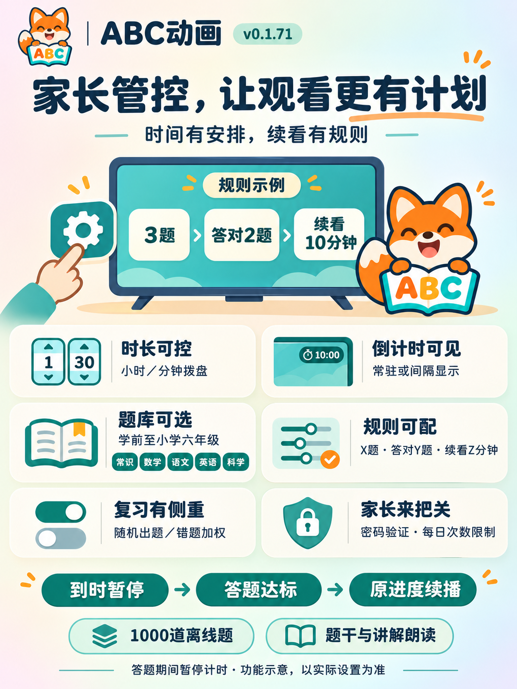

# 家长管控功能说明

适用版本：**0.1.71** · [产品首页](../README.md) · [设置步骤与操作手册](USER_GUIDE.md#10-解锁答题与续看) · [真实界面图册](SCREENSHOTS.md)

## 家长可以安排什么

| 功能点 | 可以怎样使用 |
| --- | --- |
| 内容选择 | 保存年龄与英语基础，选择语言、节目显示与片单。 |
| 每日时长 | 用小时／分钟拨盘设置每日额度，选择只计播放或包含本应用内操作。 |
| 倒计时显示 | 可关闭、顶部常驻，或每10分钟显示30秒；显示开启时最后30秒持续显示摇铃动画，无铃声。 |
| 题库选择 | 1000道离线题，学前至小学六年级，五个科目，单选、判断或混合。 |
| 答题规则 | 每轮1–10题，至少答对1–X题，获得1–60分钟续看时间。 |
| 复习安排 | 独立开关随机出题与错题加权，支持离线题干和讲解朗读。 |
| 次数限制 | 每日成功续看、每次到时尝试均可设置1–5次／轮，避免无限延长。 |
| 家长验证 | 规则由家长设置并保存；答题通过不开放家长设置权限。 |

## 一个规则示例

家长设置“3题答对至少2题，续看10分钟，每日最多成功2次，每次到时最多尝试2轮”。

到时停止播放并保留进度 → 孩子选择答题或先休息 → 完成整轮并达到门槛 → 获得当日10分钟 → 选择继续观看，回到原进度。

答题与结果页暂停计时；获得奖励后按原有计时方式使用，今日已用时间保留。每天北京时间00:00重置当日额度及每日次数。功能默认关闭，由家长决定是否启用。

## 功能点示意海报

海报中的规则、时间和拨盘为示例，实际选项以应用设置为准。下图是说明插画，真实界面请看[页面图册](SCREENSHOTS.md)。

[下载海报原图](https://github.com/suqianqiu/abc-animation/releases/download/v0.1.71/ABCAnimation-Parental-Controls-v0.1.71.png)

**2岁半之前不建议观看动画。** 管控功能是家庭约定与陪伴的辅助，题库不是官方教材或能力测评，不承诺学习效果。

如有使用问题、题目疑问或权益反馈，请及时通过[GitHub Issues](https://github.com/suqianqiu/abc-animation/issues/new/choose)联系维护者；公开材料请先遮盖个人信息。本项目用于学习交流，非营利。
