# 操作手册

适用版本：**0.1.78** · [产品首页](../README.md) · [页面图册](SCREENSHOTS.md)

## 1. 使用前准备

准备一台兼容的 Android TV 电视或电视盒子、遥控器、可用网络和足够的设备存储空间。从本项目正式发布渠道取得安装文件，并按电视提供的本地安装流程完成安装；不同品牌设备的入口可能不同。

**2岁半之前不建议观看动画。** 首次使用请由家长检查内容、语言和时长设置。只下载或播放您具备合法使用权限的内容。

旧版本可直接覆盖升级，保留现有登录、密码、设置和已下载内容。题库提供文字题目、答案与解析。

安装包分为：电视版约58.0 MB，适用于支持32位／64位ARM的电视或盒子；通用版约81.8 MB，同时包含x86_64环境支持。不确定设备类型时可选择通用版。两版功能与播放格式支持相同，任选适合设备的一版安装即可。

安装后首次打开，可以先浏览页面，再进入“设置 → 家长设置”完善档案。不要卸载或清除应用数据来解决一般下载问题，以免影响已有设置和本地内容。

## 2. 遥控器怎么用

| 操作 | 效果 |
| --- | --- |
| 上、下方向键 | 切换分类或移动到相邻控件。 |
| 左、右方向键 | 浏览同一行海报或移动按钮焦点。 |
| 确定键 | 打开海报、进入页面或执行当前按钮。 |
| 长按海报上的确定键，或按菜单键 | 查看完整标签，收藏、置顶或管理片单。 |
| 返回键 | 关闭当前弹窗、返回上一层；播放时先收起控件，再退出播放。 |

顶部导航在最左／最右边界停住，不自动换行；“添加节目”左右也停留在当前按钮，上下仍可移动到导航或节目。

导航与选项中，深绿色表示已选中，浅绿色表示悬停或遥控器焦点；海报使用轻微放大表示焦点。上下切换分类时，会恢复该行上次选过的海报；没有记录时从第一张开始。

## 3. 首页与“我的片单”

首页按内容主题、年龄和英语阶段展示分类。家长保存年龄与英语基础后，对应分类会调整到更靠前的位置；没有保存档案时使用默认排序。

“我的片单”汇集手动添加、收藏和置顶的节目。选择标题旁的“添加节目”，勾选希望放入的节目并保存；也可以长按海报进行管理。置顶内容会优先展示。

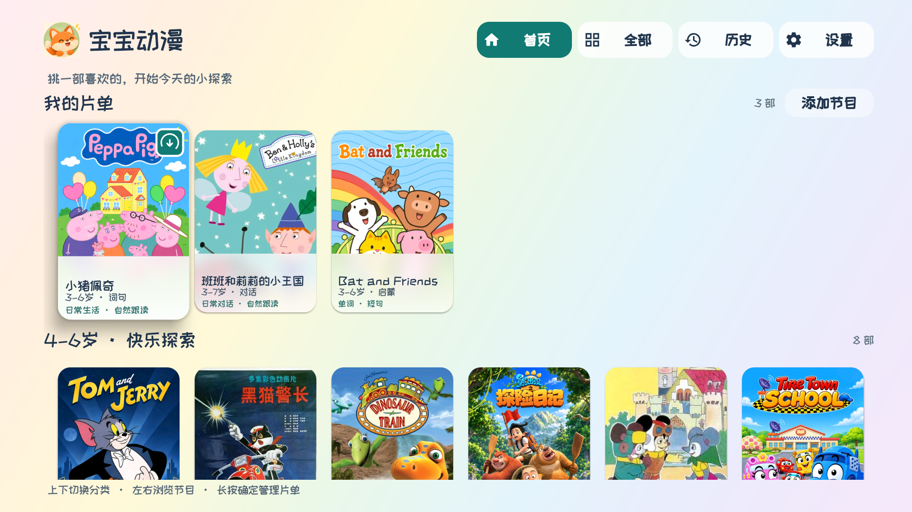

## 4. 在“全部”里找节目

进入顶部“全部”，可以按首字母、年龄、英语阶段和学习重点查找。条件可以组合使用；找不到节目时，先使用“重置筛选”。

节目上的年龄、阶段和学习重点只用于辅助选择。中文及少/无对白内容有独立标识，英语阶段不等同于孩子年龄。

家长隐藏的节目或被语言设置排除的内容，可能不会出现在当前列表中。请到“家长设置 → 节目显示”检查。

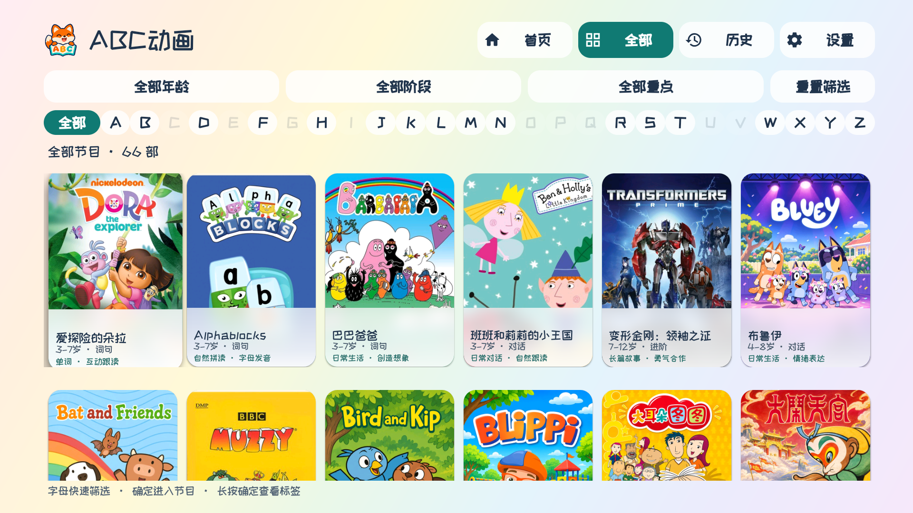

## 5. 选择季、语言与分集

打开节目海报后，在详情页选择季和语言，再选择具体分集。语言相同但来自不同内容入口时，会用“英语·数据源1”“英语·数据源2”等名称区分；这些标识不是画质或速度等级。

- **已下载的分集**：确定后直接从本地播放。
- **未下载的分集**：按提示加入下载任务，完成后再观看。
- **全部下载**：按当前选择范围和确认提示提交下载，提交前请核对设备空间。
- **显示大小**：查看分集大小；暂时无法取得大小时，以页面提示为准。
- **收藏 / 置顶**：调整该节目在“我的片单”中的展示。

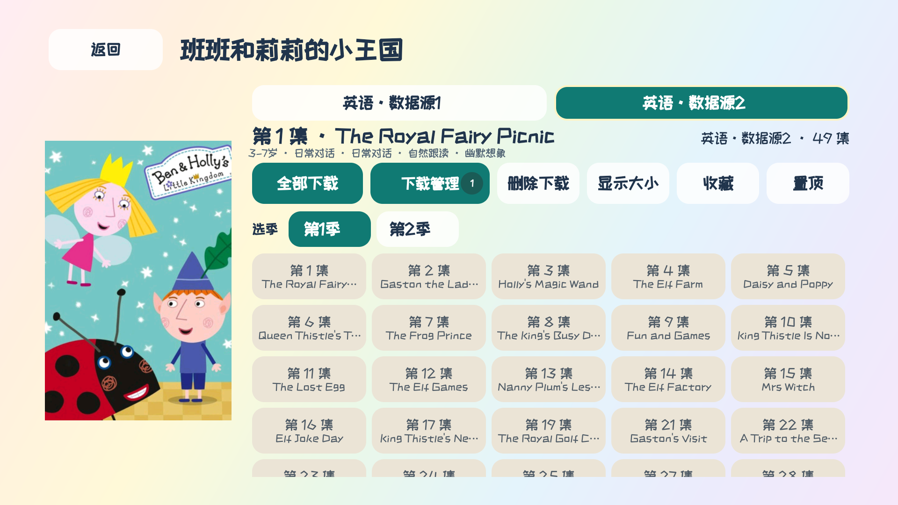

## 6. 下载与本地文件

### 查看、暂停和重试

从节目详情或“设置 → 下载管理”进入。“下载任务”显示未完成内容；点击任务名称可以查看详情。

连接临时异常时，应用会自动尝试重连，页面可能显示“连接超时 · 重试1/3”。超过自动尝试次数后会提示稍后重试；选择原任务的“重试”即可继续，不必取消重建。

**重试会保留已完成内容及可续传的进度；显式取消任务会删除该任务的临时数据。** 不要为了重试而先点“取消下载”。网盘登录失效时，请按“登录后继续”提示操作。

### 下载角标与“新”提醒

海报、季／语言入口和分集的右上角会提示对应范围的下载状态：

- **还有未完成任务**：持续显示下载动画角标，点击不会清除。角标表示该范围还有未完成任务，具体暂停、失败或传输状态请查看下载管理。
- **新完成下载**：没有其他未完成任务时，整体闪亮一次，并显示粗白框和绿色“新”标记。
- **点击后**：清除所点击入口的“新”；节目、季／语言和分集各自记录，便于继续查看刚完成的具体内容。
- **下次进入或重建页面**：已经展示过的“新”不再重复出现；当前页面的进度更新不会提前清除它。

“新”是一次性提醒，不代表文件是否仍然已下载；清除提醒不会删除文件。原有下载不会在升级后全部补标为“新”。

### 批量处理下载任务

1. 使用每条任务左侧的复选框选择，或使用“全选”。
2. 按需要选择“暂停所选”“继续/重试”或“取消所选”。
3. 取消前核对确认提示；只处理您选中的任务。

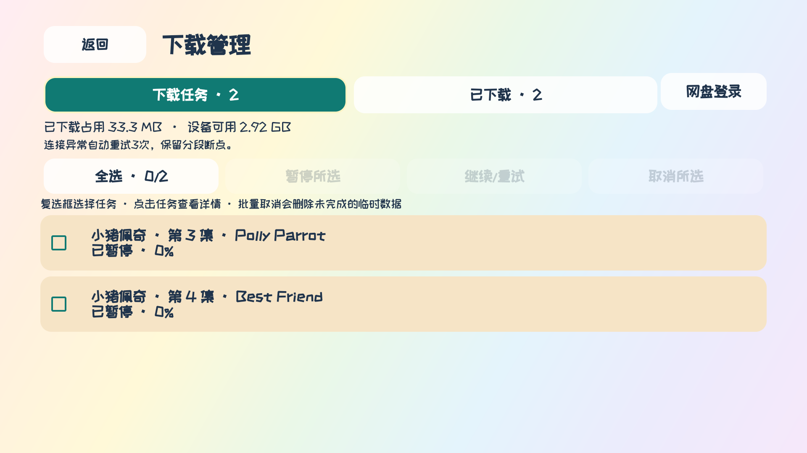

### 打开或删除已下载文件

切换到“已下载”。点击文件名称打开播放；复选框用于选择文件，不会直接开始播放。可以按节目筛选，再全选或逐个勾选。

设置了家长密码时，删除本地文件需要验证；未设置时不弹密码框。删除前确认不再需要该文件；之后若要观看，需要重新准备相应内容。取消勾选或关闭确认框不会删除文件。

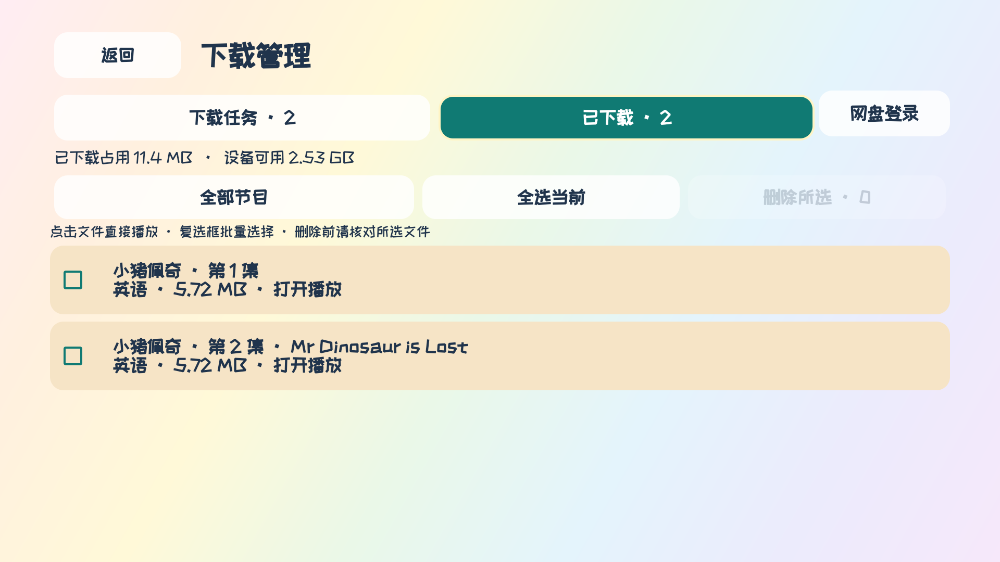

### 网盘登录与空间整理

需要登录时，由家长按电视上的提示完成手机确认。登录完成后请留意网盘清理提醒，及时在自己的网盘中整理不再需要的文件，保留可用空间。

电视本机空间与网盘空间是两回事：本机空间不足时，到“已下载”整理电视上的文件；涉及网盘空间时，请在对应网盘中处理。不要公开登录二维码或账户凭据。

## 7. 播放、字幕与连续观看

播放后可以按确定、菜单、上或下叫出控件，使用“暂停 / 继续播放”“选集”“音轨与字幕”等按钮。控件收起时，左、右方向键分别快退、快进10秒。

播放进度会保存。字幕和音轨取决于具体文件；画面固定字幕不能关闭，也不保证每集都同时提供中英文字幕或多个音轨。

**当前集结束后，紧接着的下一集已下载时会继续播放；下一集未下载则结束播放。** 应用不会为了续播自动跳过缺少的集数。

退出播放时，先按返回收起控件，再按返回离开。

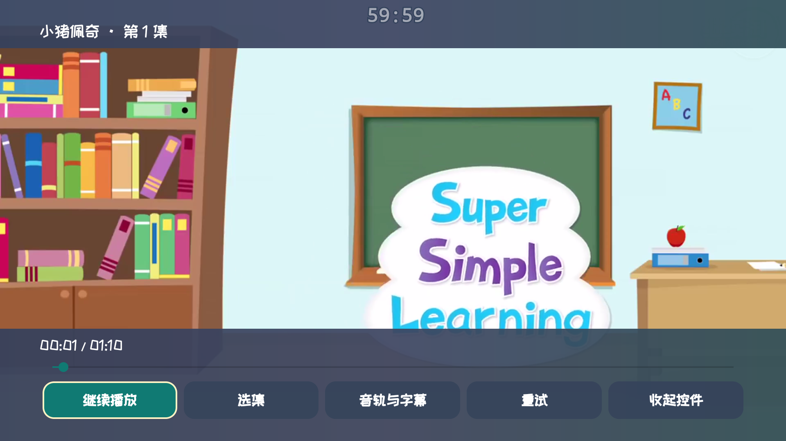

## 8. 查看最近播放历史

顶部“历史”按最近播放时间展示节目。今日、昨天和更早的具体日期各占一行，每个节目只显示最近一次记录，不会重复出现在多天。

海报下显示最近播放的分集、时间及进度。点海报可继续观看；对应本地文件已移除时，进入相应分集页面。历史从支持记录日期的版本开始积累，更早没有日期的信息不会补造。

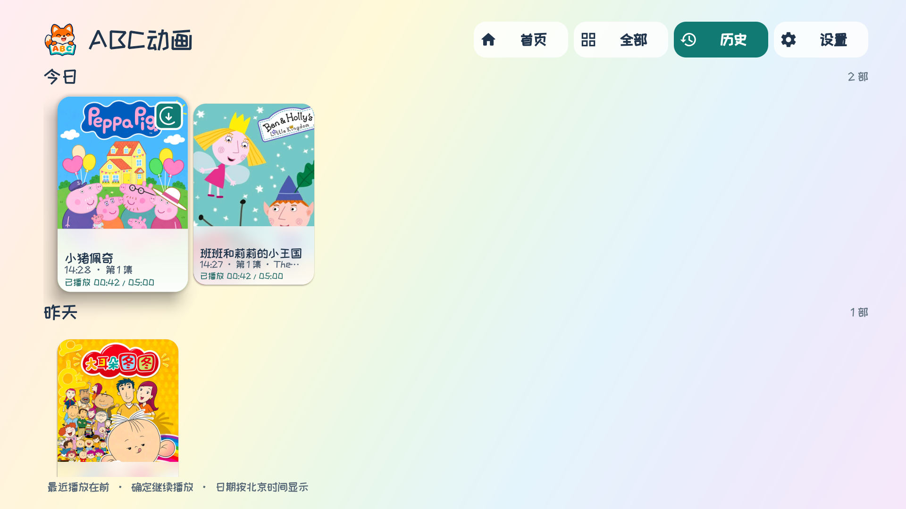

## 9. 家长设置

0.1.76将九个入口整理为等尺寸3×3图标按钮：档案、节目、时长；下载、答题、更新；密码、密码说明、网盘登录。方向键按行列移动，全部入口同时显示，无需上下滚动。

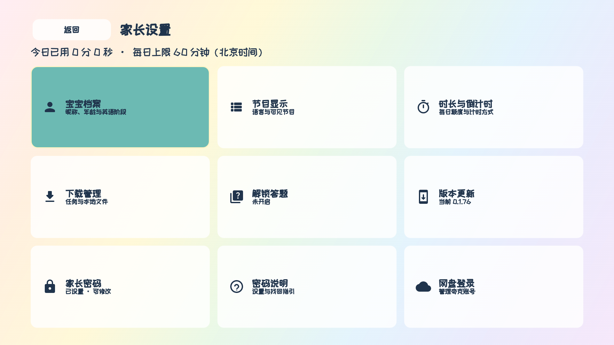

从“设置 → 家长设置”进入。**默认没有家长密码，也没有通用初始密码。**

首次进入时，会显示“设置家长密码？”引导：

- 选择“设置密码”，输入4位数字，再输入一次确认；两次一致才保存。
- 选择“暂不设置”即可继续，此后不会每次重复提示；取消密码创建也不会保存密码。
- 之后想补设时，打开“家长密码 · 未设置”。设好后会变为“更改家长密码”。
- 已经设置过密码的设备继续使用原密码，覆盖升级不会清除密码。更改密码时先验证原密码，再设置并确认新密码；取消修改保留原密码。

**未设置密码时，家长设置和相关管理操作无需密码验证。** 设置密码后，重新进入家长设置、删除本地文件等相关操作需要验证；可用遥控器数字键或屏幕数字盘输入。

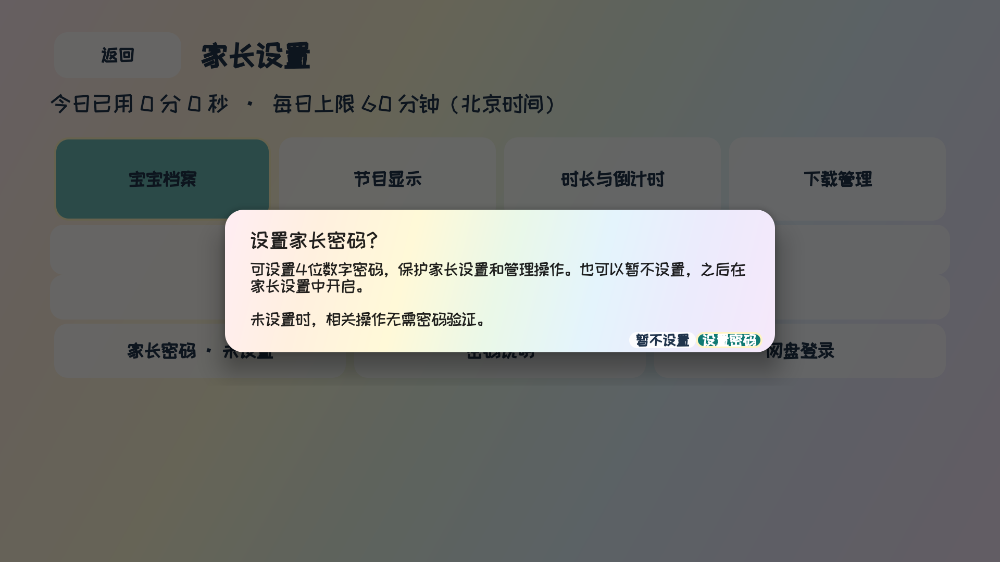

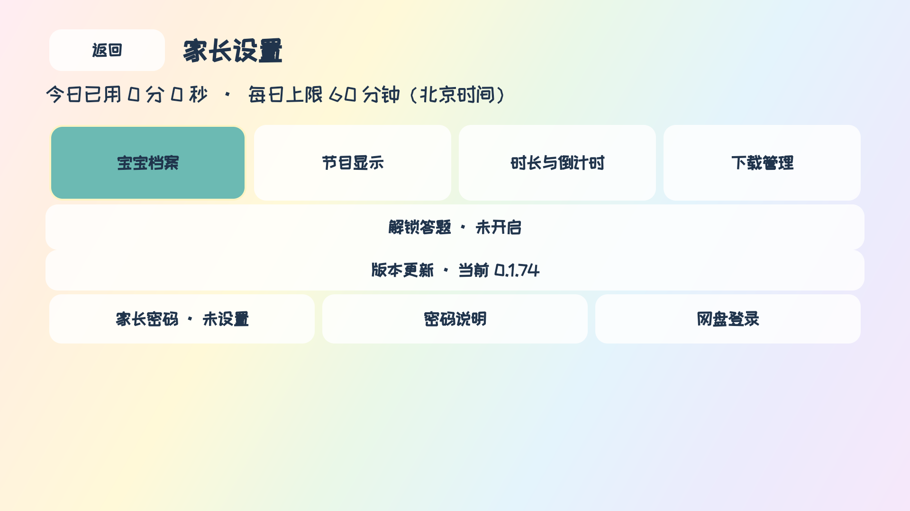

### 宝宝档案

设置昵称、年龄、英语基础、语言筛选和字幕偏好，然后选择“保存档案”。年龄前两档为“2岁半以下（不建议观看）”和“2岁半–3岁”。选择低龄档案时，首页会显示观看提醒。

### 节目显示

按英语、国语或全部语言查看并选择，也可以逐部隐藏。完成后保存；离开未保存的页面时，请按提示决定是否放弃修改。

### 时长与倒计时

进入“家长设置 → 时长与倒计时”，打开“每日可用时长”，使用小时／分钟双列拨盘：

- 左右切换小时和分钟，上下调整数值。按确定切换到分钟，再按确定移动到“保存”。
- 选择“保存”才会应用；取消或按返回不会改变原有设置。也支持点击拨盘上下方或上下滑动调整。
- 最短 1 分钟，最长 24 小时；选择 24 小时时分钟固定为 00。
- 升级后会按原来保存的时长打开，例如 60 分钟显示为 01 小时 00 分钟。

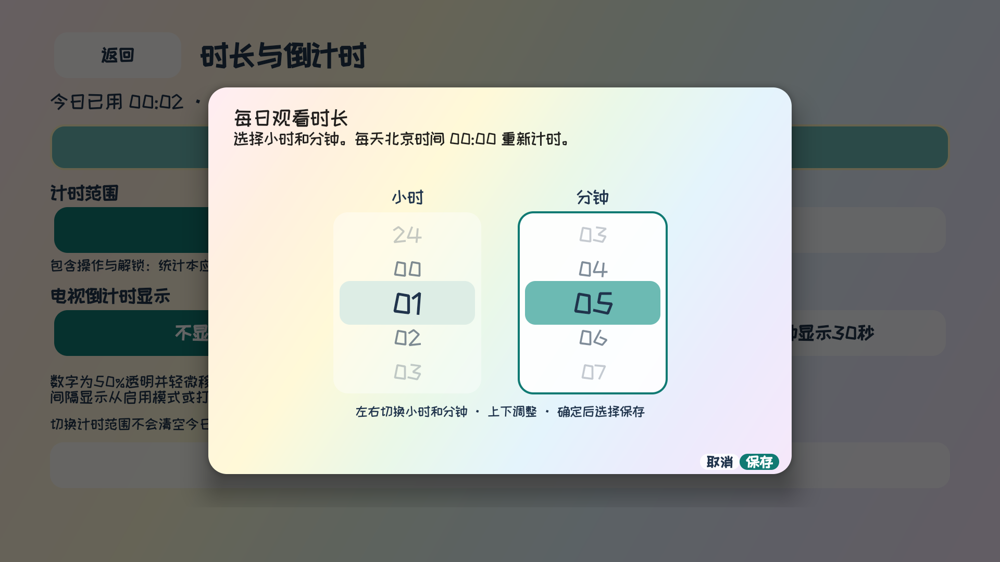

然后按需要选择计时范围：

| 计时范围 | 会计入哪些时间 |
| --- | --- |
| 只统计动画播放 | 实际播放并推进的时间；暂停与未推进的缓冲不计入。 |
| 包含操作与解锁 | 本应用在前台的使用时间，包括选片、设置、家长解锁、网盘登录和播放；答题与结果页暂停计时。离开本应用暂停计时。 |

倒计时可选择“不显示”“顶部常驻”或“每10分钟显示30秒”。数字为50%透明并轻微移动；显示开启时，最后30秒会持续显示摇铃动画，**没有铃声**。

间隔显示从打开应用或启用该模式起计算。倒计时只显示在本应用页面和播放器内，不会覆盖电视桌面或其他应用。

每日额度按**北京时间00:00**重新计算，切换计时范围不会清空今日已用时间。额度用完会停止播放，家长仍可进入设置调整。

## 10. 解锁答题与续看

### 从哪里开启

功能默认关闭，入口始终显示。进入家长设置后，可从任一入口打开；已设置家长密码时先完成验证：

1. “设置 → 家长设置 → 解锁答题”。
2. “设置 → 家长设置 → 时长与倒计时 → 解锁答题”。

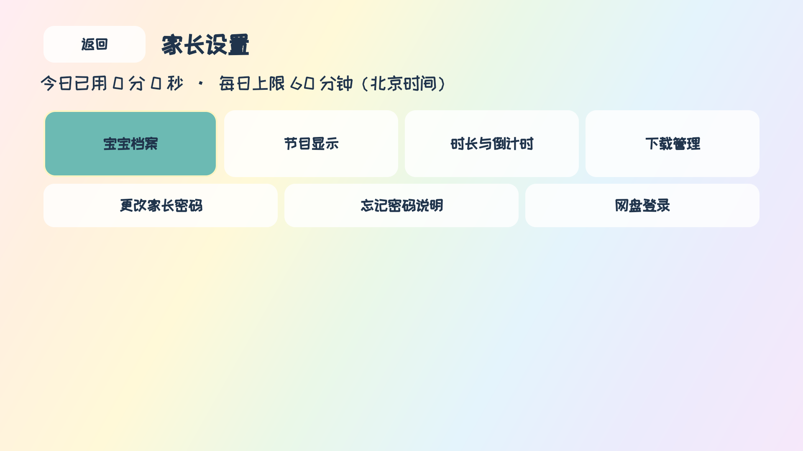

将“答题续看”切换为“已开启”，完成下面的配置，滚动到页面底部选择“保存答题设置”。未保存的修改不会生效。开启前请先与孩子约定观看安排。

### 选择题库和题型

- **年龄／年级**：学前3–4岁、4–5岁、5–6岁，以及小学一至六年级。按实际掌握情况选择。
- **英语题库**：可跟随年龄／年级，也可单独选择适合的阶段。
- **加入以前学过的年级**：按需加入较低阶段的内容。
- **科目**：常识、数学、语文、英语、科学，可多选。
- **题型**：单选题、判断题或混合题型。

内置题库共1000道，包含800道单选和200道判断题。家长可用“预览一题”先检查内容；预览不计分、不发放续看时长。筛选后题目不够时，页面会提示调整条件，保存按钮暂不可用。

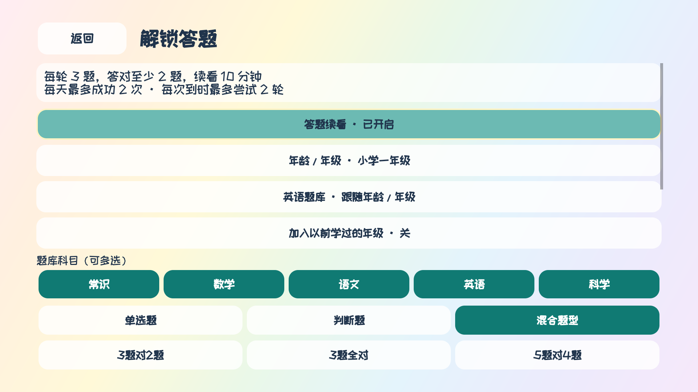

### 配置“X题、对Y题、续看Z分钟”

| 设置项 | 可选范围 | 说明 |
| --- | --- | --- |
| 每轮题数 X | 1–10道 | 一轮需要完成的题目数量。 |
| 至少答对 Y | 1–X道 | 达到门槛即可通过；仍需完成整轮。 |
| 每次续看 Z | 1–60分钟 | 用小时／分钟拨盘选择，按确定保存。 |
| 每日最多成功续看 | 1–5次 | 限制当天成功获得时长的次数。 |
| 每次到时最多尝试 | 1–5轮 | 限制同一次额度用尽后的答题机会。 |

也可先使用“3题对2题”“3题全对”“5题对4题”的快捷规则，再调整其他选项。

示例：3题至少答对2题，每次续看10分钟，每天最多成功2次，每次到时最多尝试2轮。一天最多增加20分钟，未通过的一轮不会增加时间。

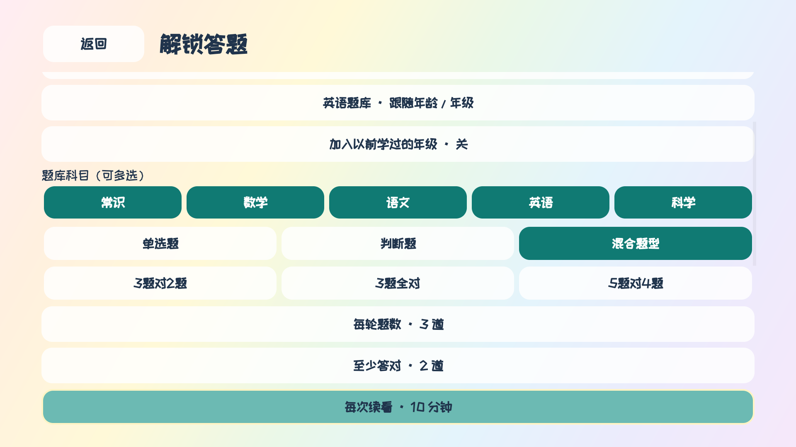

### 随机出题与错题加权

两个开关独立设置：

| 随机出题 | 错题加权 | 出题方式 |
| --- | --- | --- |
| 开 | 开 | 随机抽题，更常遇到需要复习的错题。 |
| 开 | 关 | 在所选题库中随机抽题。 |
| 关 | 开 | 优先安排错题复习。 |
| 关 | 关 | 按顺序出题。 |

题源充足时，3题最多安排1道错题、5题最多2道；一道错题在不同轮答对两次后恢复普通出题机会。

题目、答案与解析均以文字显示；选择答案并提交后查看讲解，按“下一题”继续。

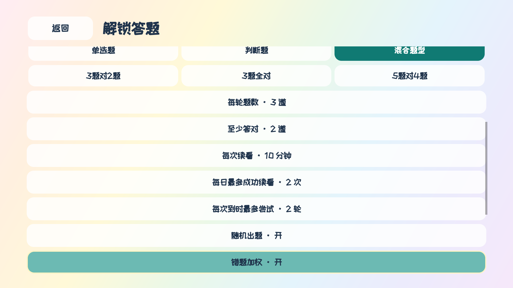

### 到时间后怎么继续

1. 今日可用时间用完，播放停止并保留进度。选择“开始答题”，也可以先休息或找家长帮助。
2. 遥控器选择答案后点“提交答案”；提交后本题不能改选，页面显示对错、正确答案与讲解。
3. 按“下一题”完成整轮。达到家长设定的门槛后获得续看时间，选择“继续观看”回到原进度。
4. 未通过时，可在剩余尝试次数内再试；用完尝试次数或每日成功次数后，先休息或请家长处理。

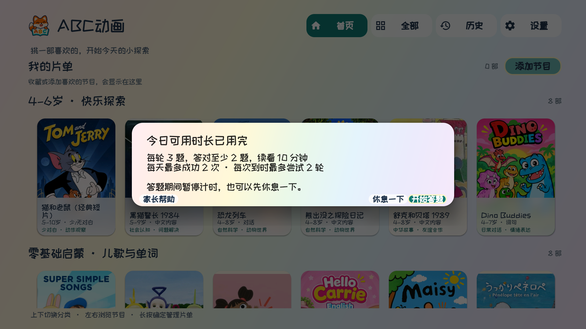

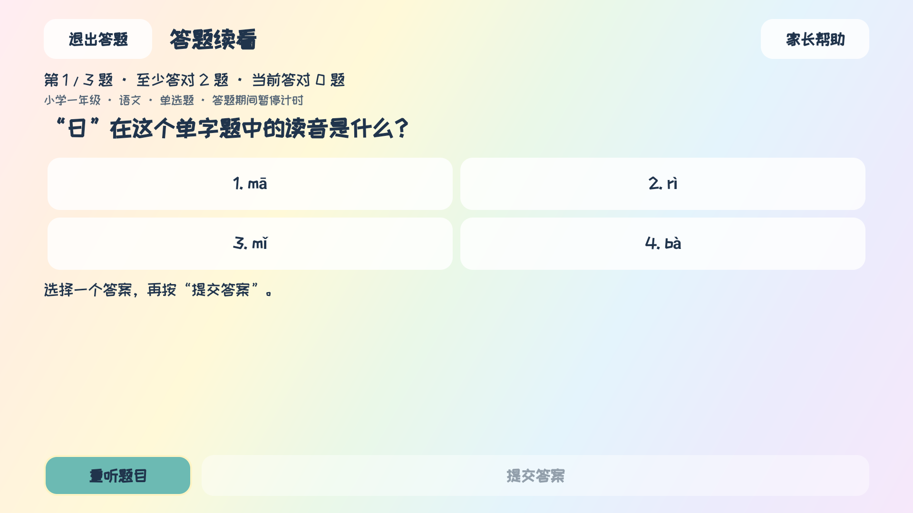

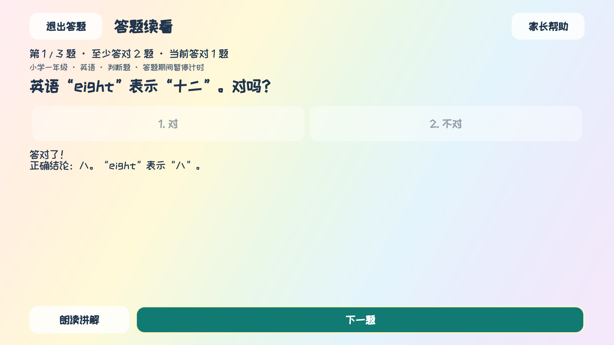

### 计时、记录与家长权限

- **答题页与结果页暂停计时**，即使选择了“包含操作与解锁”也不扣除这段时间。离开后按原计时方式继续。
- 通过只增加本日可用额度，**不会清空今日已用时间**，每轮只发放一次。未完成的一轮再次进入时可继续。
- 续看额度和每日次数按**北京时间00:00**重新计算；当日奖励不结转到次日。
- 答题通过仅用于续看，**不会取得家长权限**。已设置密码时，“家长帮助”和设置修改仍需验证；未设置时按无密码模式进入。
- 更改基础时长或保存新规则可能更新当前待答状态，当天已成功获得奖励的次数仍保留；修改设置本身不发放答题奖励。

题库分级供家长参考，不是考试或能力测评。题目有疑问时，请在 Issues 中提供题目文字、年级与科目，避免公开孩子个人信息。

## 11. 检查与安装更新

安装0.1.74或之后的版本后，每天首次打开应用会在后台检查新版本，按北京时间计算。检查失败会稍后重试；离线时仍可观看已下载内容。发现更新会显示提示，由家长决定是否升级，不会自动开始安装。

### 查看与下载

1. 进入“设置 → 家长设置 → 版本更新”。已设置家长密码时，先验证密码。
2. 查看当前版本、上次检查时间和新版本说明，也可以点“重新检查”。
3. 点“下载更新”。页面显示进度，可暂停；中断或离开页面后，返回点“继续下载”。
4. 下载并校验完成后，点“立即安装”。建议先停止观看；安装期间应用会短暂退出。

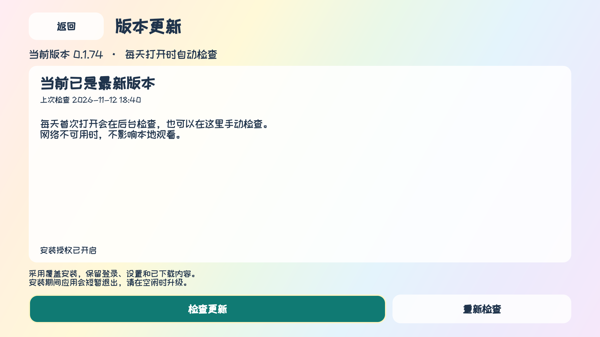

### 第一次允许安装

1. 第一次点“立即安装”，若尚未授权，会显示引导，点“前往设置”。
2. 在电视系统页面中找到“ABC动画”，开启“允许来自此来源”或对应安装开关。
3. 按遥控器返回，应用会继续本次安装准备，再按系统提示选择“更新”或“安装”。
4. 覆盖安装保留现有登录、家长设置和下载内容，请勿卸载旧应用或清除数据。
5. 安装完成后，重新打开ABC动画。

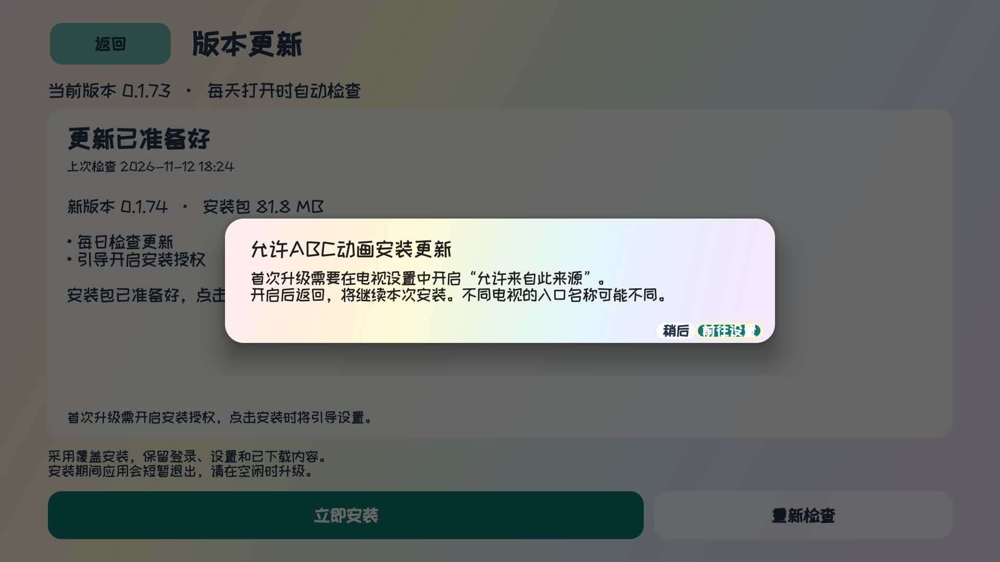

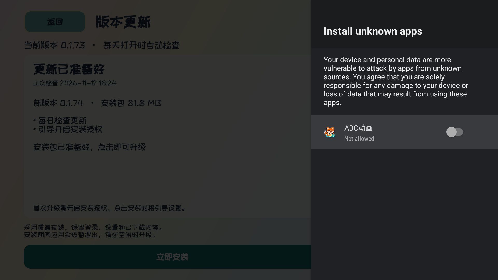

不同品牌电视的入口名称和系统确认步骤可能不同。未开启时可稍后重新前往设置；已授权的设备通常不必重复开启。若不能直接打开授权页，按提示在电视“安全”或“应用安装”设置中操作。厂家禁止第三方安装的设备，仍需采用该电视支持的安装方式；应用无法替代系统授权。

旧版没有这个入口时，请先从[正式发布页](https://github.com/suqianqiu/abc-animation/releases/tag/v0.1.76)下载并覆盖安装本版，之后即可使用应用内更新。电视上检查或下载失败时，也可手动下载安装包覆盖升级。

## 12. 常见问题

| 遇到的情况 | 建议处理 |
| --- | --- |
| 更新检查失败 | 检查网络后点“重新检查”；不影响本地观看，也可从正式发布页手动下载安装包。 |
| 更新被系统阻止 | 根据引导允许ABC动画安装应用；若电视有厂家安装限制，采用电视支持的安装方式。 |
| 找不到某个节目或语言 | 重置“全部”的筛选，再检查家长设置中的节目显示与语言筛选。 |
| 电视版无法安装 | 确认设备支持ARM，或改用通用版；保留原应用数据，直接覆盖安装。 |
| 下载提示连接超时 | 等待自动尝试；仍失败时稍后点原任务“重试”，同时检查网络。 |
| 提示需要登录 | 由家长完成网盘登录确认，再继续任务。 |
| 下载一直很慢 | 查看网络、其他下载占用及内容提供方状态；自动重试不保证提高下载速度。 |
| 提示空间不足 | 分别检查电视本机与网盘空间，确认后整理不再需要的内容。 |
| 下一集没有自动播放 | 确认紧接着的下一集已经下载，并检查今日可用时长。 |
| 字幕无法切换 | 查看文件实际提供的字幕；固定在画面中的字幕无法关闭。 |
| 找不到旧的历史日期 | 只展示最近一次记录；没有保存过日期的旧记录无法追溯。 |
| 找不到答题续看 | 两个入口都在家长设置内；已设置密码时先验证，功能需开启并保存。 |
| 答题设置不能保存 | 按页面提示增加题库范围、选择科目，或减少每轮题数。 |
| 答题通过却不能再次答题 | 检查每日成功次数及本次尝试次数；当前还有可用时间时先按规则使用。 |
| 倒计时暂时没显示 | 检查是否选择“不显示”，或正处于间隔显示的隐藏时段。 |

仍有问题时，请通过[本项目的 GitHub Issues](https://github.com/suqianqiu/abc-animation/issues/new/choose) 联系维护者，说明电视型号、应用版本、操作步骤和看到的提示；截图请先遮盖个人信息。

使用前请阅读[使用声明、隐私与免责声明](NOTICE.md)。

## 13. 焦点与弹窗

首页上下选行时，中间行在海报区域居中；首尾按边界停住。低版本电视关闭系统动画时也会连续滚动，无需修改电视全局设置。

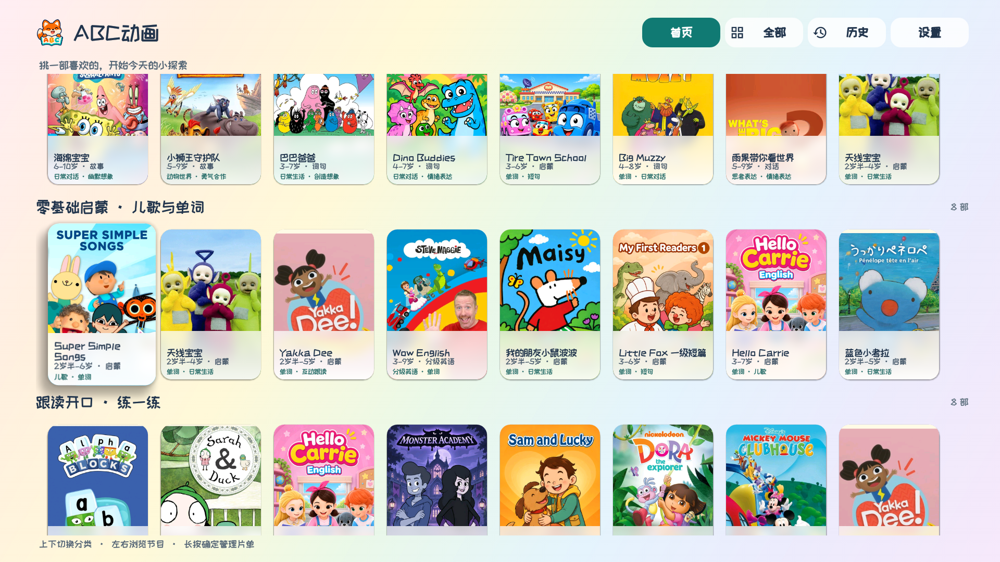

确认与取消按钮使用一致尺寸和焦点状态；短弹窗按内容收缩，长内容只在内部滚动，底部操作区固定。删除确认默认聚焦取消，按Back可关闭。

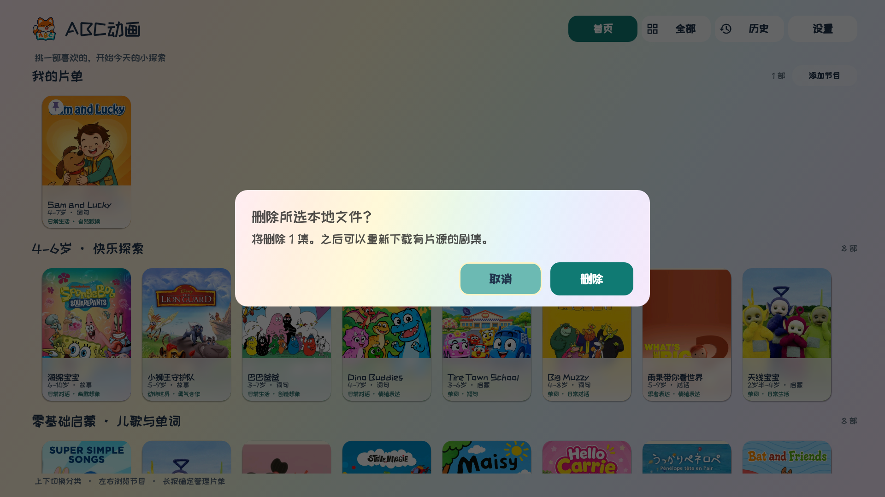

## 14. 旧系统无法检查更新

原版0.1.74–0.1.76遇到证书问题时，请先通过电脑下载0.1.77覆盖安装一次，再使用应用内更新。[详细兼容说明](UPDATE_COMPATIBILITY.md)。这不等于国内网络访问保证；请根据证书、DNS或超时提示判断原因。

## 15. 腾讯云优先升级

0.1.78开始，版本检测和下载优先使用腾讯云香港COS，GitHub自动备用。下载中断会保留进度，可以继续；下载完成校验后，点击“立即安装”并按系统提示确认。旧版本需要先覆盖安装一次新升级模块。详见[升级主备机制](UPDATE_COMPATIBILITY.md)。
